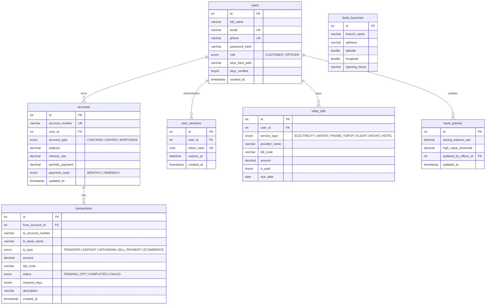

# Industrial and Commercial Bank of TDTU (ICBT Bank)

Đồ án môn học **Mobile Apps Development** — Khoa Công nghệ Thông tin, Trường Đại học Tôn Đức Thắng (TDTU).  
Ứng dụng ngân hàng số trên nền tảng **Android (Java)** kết hợp **REST API (PHP 8.3)** và **MySQL / MariaDB**.

---

## 1. Kiến trúc hệ thống

```text
+--------------------------+        HTTPS / JSON        +---------------------------+        PDO (ACID)        +------------------------+
|   Android App (Java)     |  <---------------------->  |   Backend PHP 8.3 API     |  <------------------>  |   MySQL / MariaDB      |
|  Retrofit2 + Gson + UI   |   https://phatg.id.vn/api  |  (DirectAdmin Hosting)    |   Prepared Statements  |   6 Bang InnoDB (ERD)  |
+--------------------------+                            +---------------------------+                        +------------------------+
```

### Công nghệ sử dụng
* **Mobile (Android):** Java 11, Material 3, ConstraintLayout, `minSdk 24` / `targetSdk 37`.
* **Networking & Serialization:** Retrofit `2.11.0`, Gson Converter, OkHttp Logging Interceptor `4.12.0`.
* **Backend:** PHP `8.3` (PDO, `password_hash` bcrypt + salt, Bearer Token Authentication + RBAC, `PDO::beginTransaction` với `FOR UPDATE`).
* **Database:** MySQL / MariaDB (`InnoDB`, `utf8mb4_unicode_ci`).

---

## 2. Cấu trúc thư mục dự án

```text
Industrial_and_Commercial_Bank_of_TDTU/
├── app/src/main/
│   ├── AndroidManifest.xml
│   ├── java/com/example/industrial_and_commercial_bank_of_tdtu/
│   │   ├── MainActivity.java                 # Khung dieu huong Single-Activity + Bottom Nav
│   │   ├── LoginFragment.java                # Dang nhap & phan luong Customer / Officer
│   │   ├── HomeFragment.java                 # Trang chu, so du & lich su gan day
│   │   ├── CreditCardFragment.java           # Chi tiet 3 loai tai khoan (Checking/Saving/Mortgage) & The
│   │   ├── ProfileFragment.java              # Ho so khach hang & trang thai eKYC
│   │   ├── TransactionHistoryFragment.java   # Lich su giao dich
│   │   ├── UtilitiesFragment.java            # Tien ich (Dien, Nuoc, Nap DT, Ve, Khach san...)
│   │   ├── ElectricityFragment.java          # Tra cuu & thanh toan hoa don dien + Receipt
│   │   ├── WaterFragment.java                # Tra cuu & thanh toan hoa don nuoc + Receipt
│   │   ├── TopUpFragment.java                # Nap tien dien thoai + Receipt
│   │   ├── ReceiptFragment.java              # Bien lai giao dich
│   │   ├── ChatBotFragment.java              # Giao dien tro ly AI
│   │   ├── DashBoard.java                    # Trang quan tri cua Bank Officer
│   │   ├── CustomerManager.java              # Quan ly khach hang (Officer)
│   │   ├── SystemConfig.java                 # Cau hinh lai suat he thong (Officer)
│   │   ├── ManagerProfile.java               # Ho so & dang xuat cua Officer
│   │   ├── adapter/
│   │   │   └── TransactionAdapter.java       # Adapter do du lieu giao dich vao ListView
│   │   ├── model/                            # POJO/DTO hung JSON tu API & UI
│   │   ├── network/                          # ApiClient, BankApiService, SessionManager (in-RAM)
│   │   └── repository/                       # UtilityMockRepository (mock hoa don tam thoi)
│   └── res/layout/                           # Layout XML cho cac man hinh & dialog
└── backend/
    ├── database.sql                          # Schema 7 bang + du lieu mau
    └── api/
        ├── .htaccess                         # Giu header Authorization: Bearer tren Apache
        ├── config/
        │   ├── .htaccess                     # Chan truy cap truc tiep thu muc config/
        │   ├── config.example.php            # File mau cau hinh DB & API keys
        │   └── db.php                        # PDO connection, requireAuth & requireOfficer
        ├── health.php                        # Kiem tra PHP & MySQL
        ├── auth/
        │   ├── login.php                     # Dang nhap & cap Bearer token
        │   └── logout.php                    # Thu hoi token phien dang nhap
        ├── accounts/list.php                 # Lay 3 loai tai khoan theo Bearer token
        ├── transactions/
        │   ├── history.php                   # Lich su giao dich theo Bearer token
        │   ├── transfer.php                  # Chuyen tien + xac thuc OTP 2FA
        │   └── deposit_withdraw.php          # Nap / Rut tien tai khoan CHECKING
        ├── utilities/
        │   ├── bills.php                     # Tra cuu hoa don
        │   └── pay.php                       # Thanh toan hoa don (ACID Transaction)
        ├── officer/
        │   ├── customers.php                 # Danh sach & tao khach hang moi (OFFICER)
        │   └── update_policy.php             # Cap nhat lai suat & han muc eKYC (OFFICER)
        └── branches/list.php                 # Danh sach chi nhanh ngan hang
```

---

## 3. Thiết kế Cơ sở dữ liệu (ERD)



---

## 4. Trạng thái triển khai các tính năng

| Phân hệ | Trạng thái | Ghi chú |
| :--- | :---: | :--- |
| **Database & PHP API khung** | ✅ Hoàn thành | `database.sql` (7 bảng) + `health.php`, `login.php`, `logout.php`, `accounts/list.php`, `transactions/history.php`, `branches/list.php`. |
| **Xác thực, Bảo mật & Phiên đăng nhập** | ✅ Hoạt động | Đăng nhập qua MySQL (`bcrypt` + salt), cấp **Bearer Token** (hết hạn sau 30 phút không thao tác, thu hồi khi Logout/thoát app), phân quyền RBAC (`CUSTOMER` / `OFFICER`) chống truy cập trái phép. |
| **Quản lý 3 loại tài khoản & Hồ sơ** | ✅ Hoạt động | Hiển thị số dư `CHECKING`, `SAVING` (lãi suất & tiền lời/tháng), `MORTGAGE` (số tiền trả theo tháng/2 tuần), thông tin cá nhân & lịch sử giao dịch. |
| **Chuyển/Nạp/Rút, Hóa đơn & Officer** | 🟡 Đã có UI + PHP API | PHP API (`transfer.php`, `deposit_withdraw.php`, `utilities/pay.php`, `officer/*`) đã sẵn sàng; phía Android đang nối từ dialog/fragment thay cho mock. |
| **eKYC khuôn mặt, Stripe, Bản đồ & AI Chatbot** | ⬜ Đang phát triển | Đã có dữ liệu chi nhánh (`bank_branches`), khung UI `ChatBotFragment` và thiết kế tích hợp ở các bước tiếp theo. |

---

## 5. Hướng dẫn cài đặt & Chạy thử

### Bước 1: Cài đặt Backend & Database
1. Tạo database MySQL trên hosting (hoặc XAMPP/Laragon local) và import file [`backend/database.sql`](backend/database.sql) qua **phpMyAdmin**.
2. Copy file [`backend/api/config/config.example.php`](backend/api/config/config.example.php) thành `backend/api/config/config.php` và điền thông tin kết nối (`DB_HOST`, `DB_NAME`, `DB_USER`, `DB_PASS`).
   > File `config.php` đã được khai báo trong `.gitignore` để bảo mật thông tin khi đẩy code lên GitHub.
3. Upload thư mục `backend/api/` lên hosting (ví dụ `public_html/api/`) và kiểm tra trình duyệt tại `https://<domain>/api/health.php`.

### Bước 2: Chạy ứng dụng Android
1. Mở project bằng **Android Studio**, kiểm tra `BASE_URL` trong [`ApiClient.java`](app/src/main/java/com/example/industrial_and_commercial_bank_of_tdtu/network/ApiClient.java) trỏ tới API của bạn.
2. Sync Gradle và chạy trên Emulator hoặc thiết bị Android (`minSdk >= 24`).

### Tài khoản mẫu để kiểm thử (Mật khẩu chung: `123456`)
| Vai trò | SĐT | Email | Giao diện mở ra |
| :--- | :--- | :--- | :--- |
| `CUSTOMER` | `0901234567` | `phat.tran@tdtu.edu.vn` | Giao diện Khách hàng (`HomeFragment`) |
| `CUSTOMER` | `0909876543` | `anh.nguyen@tdtu.edu.vn` | Giao diện Khách hàng (`HomeFragment`) |
| `OFFICER` | `0911222333` | `officer@icbtdtu.vn` | Giao diện Nhân viên (`DashBoard`) |
